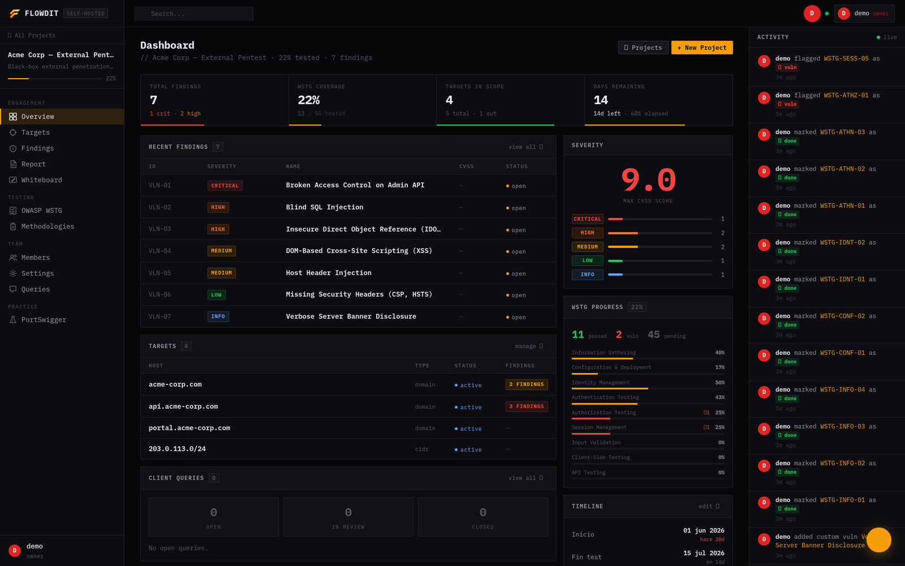
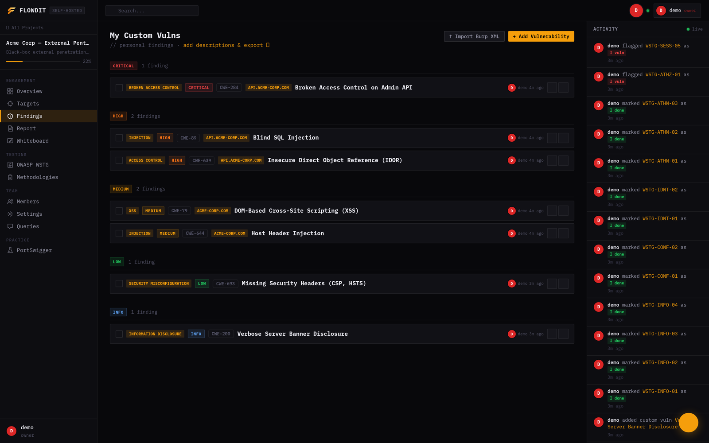
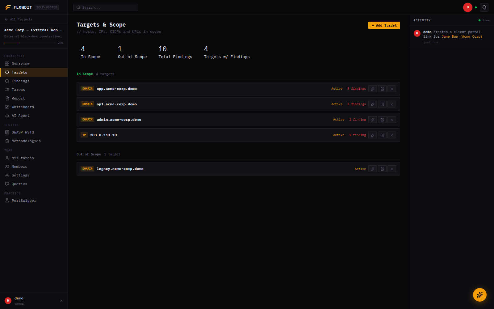
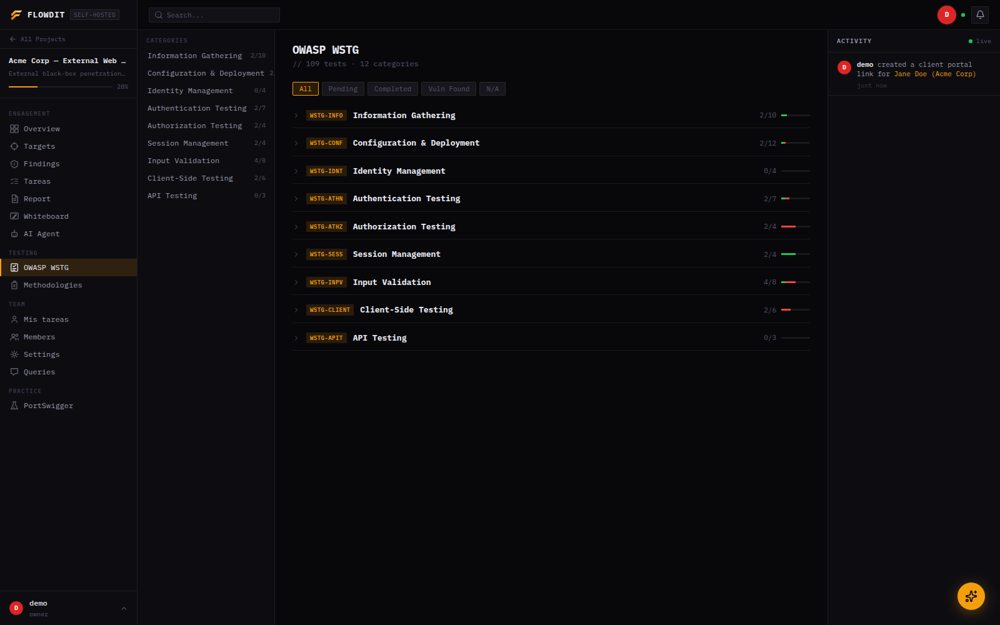
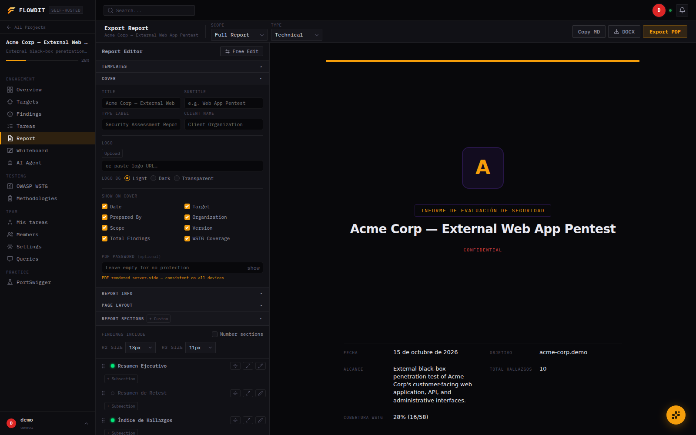
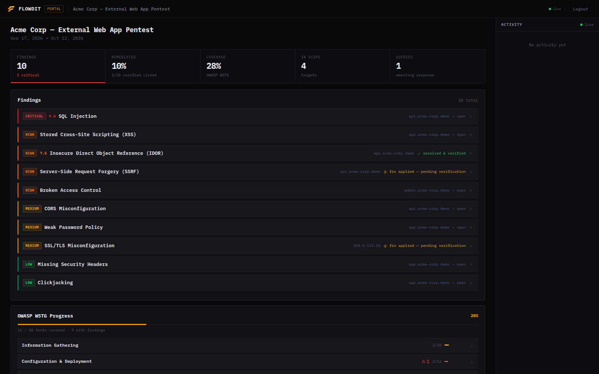

<p align="center">
  
</p>

<p align="center">
  Self-hosted pentest engagement management platform — findings, targets, methodologies, an autonomous AI scanner, client portal, and professional reports in one place.
</p>

<p align="center">
  
  
  
</p>

<p align="center">
  
</p>

---

## What is Flowdit?

Flowdit is a self-hosted platform built for penetration testers and security consultants. It centralizes everything that happens during an engagement — findings, targets, methodology checklists, team activity — and exposes a live read-only portal so clients can follow the project in real time.

No more delivering a PDF at the end and hoping the client trusts the process. With Flowdit, they see it as it happens.

It also ships an autonomous AI agent that can run a scan session on its own — enumerating, testing, and proposing findings for a human to approve — and scales from a single freelancer to a multi-tenant organization with SSO.

> **Language:** the product UI and AI-generated reports are Spanish-only (built for the LatAm/Spain pentest market). This documentation is in English for reach, but expect Spanish strings throughout the app itself.

---

## Features

### AI Pentest Agent

An autonomous scanning agent, run per-project from its own chat-style session view. It works through recon and testing tools on its own, gates riskier actions (HTTP requests, exploit PoCs, proposing a finding) behind human approval, and checkpoints itself instead of running unattended forever.

- Multi-provider: Groq, Anthropic (Claude), DeepSeek, Kimi (Moonshot), or any local/OpenAI-compatible server (Ollama, LM Studio, vLLM)
- Per-session cost cap (`$`) and iteration checkpoints, on top of the existing per-project spend tracking
- Session profiles — standard pentest, CTF, or HTB/THM-style lab — change how aggressively it works and what it reports
- Optional multi-agent orchestration: a coordinator thread can delegate to sub-agents that run in parallel
- Survives a backend restart mid-session — orphaned scan threads resume automatically

### Findings & Vulnerability Tracking



- Custom vulnerability library with severity, CVSS v3.1 scoring, CWE, checklist items, payloads, and notes
- Built-in interactive CVSS v3.1 calculator with vector string generation
- Reusable vulnerability templates — add common findings (SQLi, XSS, IDOR, SSRF…) with pre-written description and remediation in one click
- Remediation workflow — finding → remediated → retest → verified closed, with audit trail (who, when)
- PCI-DSS compliance tagging per finding, surfaced in both PDF and DOCX reports
- Evidence attachments (screenshots) per finding
- HTTP Proofs — import request/response pairs from Burp Suite, annotate with markdown, include selectively in reports
- Findings can be marked as AI-generated when they came from the AI Agent

### Scan Imports

Auto-detected by file content, all sharing one endpoint:

- Burp Suite XML
- Nessus (`.nessus`)
- OWASP ZAP XML
- Nmap XML (`nmap -oX`) — populates targets and open ports directly

### Targets & Scope



- Track hosts, IPs, CIDRs, URLs with in/out-of-scope status
- Port and service inventory per target
- Endpoint tracking with HTTP method, status code, and notes

### Methodologies



- Full OWASP WSTG checklist with per-test notes and status
- PortSwigger Web Security Academy lab tracker
- Custom methodology builder — create reusable test libraries for your team

### Reporting



- PDF export — professional report with executive summary, findings, risk breakdown, evidence, HTTP proofs, WSTG results, PCI-DSS coverage, and targets table. Configurable sections, fonts, accent color, watermark, page header/footer, and password encryption
- DOCX export — full Word document generated server-side, no LibreOffice required
- Report builder configuration is persisted per project (not just in the browser), and reusable as saved templates

### Client Portal



- Read-only view for clients, accessible via invite link
- Configurable visibility: findings, WSTG progress, targets, activity feed
- Ticket system — clients can open queries linked to specific findings; team responds in thread
- Push a ticket to GitHub Issues with one click (per-project repo + token, see [GITHUB_INTEGRATION.md](GITHUB_INTEGRATION.md))

### Organizations & Access

- Multi-tenant organizations — group projects under a company account with owner/admin/member roles; owners/admins see every project without per-project invites
- Team members with per-project roles: owner, editor, viewer
- SSO via Microsoft Entra ID (OIDC), configured per organization, with JIT user provisioning and optional enforcement per email domain
- Two-factor authentication (TOTP), opt-in per user, independent of SSO

### Collaboration & Platform

- Real-time activity feed via WebSockets, membership-checked per project
- Collaborative whiteboard per project
- Project branding — upload logo per engagement
- Timeline tracking with start, end, and report dates
- Dark and light theme, compact density mode
- Hardened by default — CSP headers, sanitized Markdown rendering, no CDN dependencies at runtime

---

## Stack

| Layer         | Technology                                                        |
|---------------|--------------------------------------------------------------------|
| Backend       | Node.js + Express                                                   |
| Database      | PostgreSQL 15+                                                       |
| Auth          | JWT (access + refresh tokens), OIDC SSO, TOTP 2FA                    |
| Realtime      | WebSockets                                                           |
| AI providers  | Groq, Anthropic, DeepSeek, Kimi, or any local/OpenAI-compatible model |
| Frontend      | Vanilla JS, HTML, CSS                                                |
| Reverse proxy | Nginx                                                                |
| Process       | PM2                                                                  |
| PDF export    | Puppeteer (Chromium headless)                                        |
| DOCX export   | docx (native, no LibreOffice)                                        |

---

## Self-hosting

### Requirements

- Ubuntu 22.04 LTS (or similar)
- Node.js 18+
- PostgreSQL 15+
- Nginx
- PM2 (`npm install -g pm2`)
- A domain with DNS pointed to your server
- Chromium or Google Chrome (for PDF export)

### Try it in one command (Docker)

Spins up Postgres + backend (with Chromium/Ghostscript for PDF export) + Nginx, no manual setup:

```bash
git clone https://github.com/Pirrandi/flowdit.git
cd flowdit
docker compose --profile full up -d --build
```

Then open http://localhost. This is meant for trying Flowdit locally, not for production — see [DEPLOY.md](DEPLOY.md) for a real deployment (systemd/PM2, SSL, hardened env).

### Manual setup

```bash
# 1. Clone the repo
git clone https://github.com/Pirrandi/flowdit.git
cd flowdit

# 2. Configure environment
cp .env.example .env
# Edit .env with your values (DB credentials, JWT secret, domain)

# 3. Install backend dependencies
cd backend && npm install && cd ..

# 4. Run database migrations
cd backend && node src/db/migrate.js && cd ..

# 5. Start the backend with PM2
cd backend && pm2 start src/index.js --name flowdit-backend
pm2 save && pm2 startup

# 6. Configure Nginx
# Point your domain root to frontend/
# Proxy /api and /ws to the backend port (default: 4000)
# See DEPLOY.md for the full Nginx config and SSL setup
```

### Environment variables

| Variable            | Description                                                    | Required |
|---------------------|------------------------------------------------------------------|----------|
| `PORT`              | Backend port (default: 4000)                                     | No       |
| `DB_HOST`           | PostgreSQL host                                                   | Yes      |
| `DB_PORT`           | PostgreSQL port (default: 5432)                                   | No       |
| `DB_NAME`           | Database name                                                     | Yes      |
| `DB_USER`           | Database user                                                     | Yes      |
| `DB_PASSWORD`       | Database password                                                 | Yes      |
| `JWT_SECRET`        | Secret for JWT signing (min 64 chars)                             | Yes      |
| `CORS_ORIGIN`       | Allowed frontend origin(s)                                        | Yes      |
| `FRONTEND_URL`      | Frontend URL, used in email links                                 | Yes      |
| `SSO_ENCRYPTION_KEY`| Encrypts per-org OIDC client secrets and 2FA secrets at rest      | Only if using SSO/2FA |
| `PUBLIC_API_URL`    | This backend's externally-reachable origin, for the SSO redirect URI | Only if using SSO |
| `INTERNAL_APP_URL`  | Internal URL Puppeteer uses to reach the frontend for PDF export  | Yes (falls back to `FRONTEND_URL`) |
| `DEMO_MODE`         | Blocks a few destructive actions on a shared demo account         | No       |
| `SMTP_HOST`/`SMTP_USER`/`SMTP_PASS` | SMTP server for client-portal email notifications | No       |
| `GROQ_API_KEY` / `ANTHROPIC_API_KEY` / `DEEPSEEK_API_KEY` / `KIMI_API_KEY` | Keys for the AI providers you plan to use, picked per project | No |
| `CUSTOM_API_URL`/`CUSTOM_API_KEY`/`CUSTOM_MODEL` | Local/OpenAI-compatible model server (Ollama, LM Studio, vLLM…) | No |

See `.env.example` for the full list with descriptions.

---

## Project structure

```
flowdit/
├── backend/
│   └── src/
│       ├── db/           # PostgreSQL client + migrations (idempotent)
│       ├── middleware/   # Auth guards, project/org access control
│       ├── routes/       # REST API endpoints
│       └── services/
│           ├── ai/       # Multi-provider AI clients + the scan agent loop
│           └── ...       # WebSocket hub, activity log, DOCX renderer, mailer, SSO
├── frontend/
│   ├── css/              # Global styles (Signal design system)
│   ├── img/              # Logo, favicon
│   ├── js/
│   │   ├── views/        # Page-level JS (dashboard, vulns, targets, ai-agent…)
│   │   ├── services/     # API client, state, WebSocket client, utils
│   │   ├── components/   # Shared UI (activity feed)
│   │   └── vendor/       # Vendored, sanitized markdown/DOMPurify (no CDN)
│   └── *.html            # One HTML file per view
└── nginx/                # Nginx config reference
```

---

## Roadmap

- [ ] Public demo instance deployed (seed script and demo-mode guard are done — see [ROADMAP.md](ROADMAP.md))
- [ ] Email notifications for ticket replies
- [ ] CVSS v4.0 support
- [ ] SSO — Okta, Google Workspace, and pure SAML
- [ ] Managed hosting (paid tier)
- [ ] White-label branding

See [ROADMAP.md](ROADMAP.md) for the full adoption/product/monetization plan and what's already shipped.

---

## Contributing

Contributions are welcome. See [CONTRIBUTING.md](CONTRIBUTING.md) for guidelines.

---

## License

MIT — see [LICENSE](LICENSE) for details.
